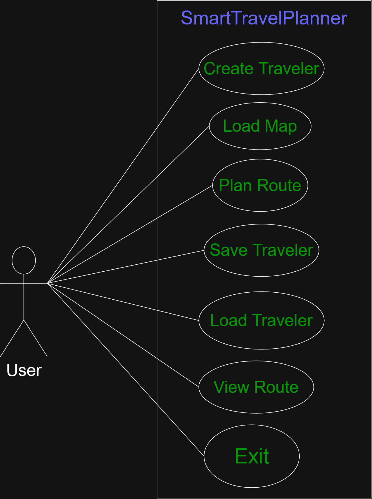
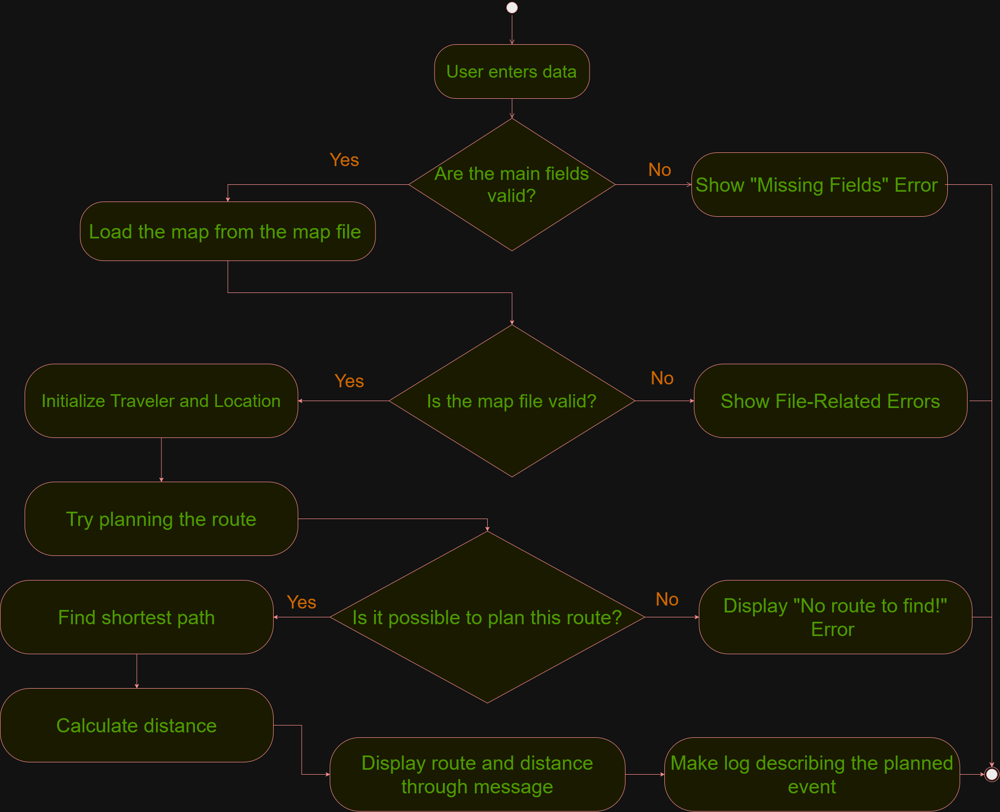

# Mission-Control
The visual design of our application was entirely inspired by the dark fantasy aesthetic of the `Darkest Dungeon` series. We believe that such a *Dark Fantasy* theme is the best option for such a route planner application. It encourages fans of the genre to use this app more often than other applications like that.
## USE CASE Diagram

This Use Case diagram illustrates the interactions between the *User* and the *SmartTravelPlanner system*. It outlines seven main actions available to the User: **managing traveler profiles** (*creating, saving, and loading*), **handling navigation data ** (loading maps and planning routes*), **viewing the active route**, and **exiting the application**.
## ACTIVITY Diagram

This Activity Diagram illustrates the internal workflow of the SmartTravelPlanner application. It describes the step-by-step execution logic from initial data entry to the final route calculation, highlighting essential system details, such as error-handling paths for missing inputs, invalid map files, and unreachable destinations.
## SEQUENCE Diagram
TODO the description of the diagram and diagram itself
